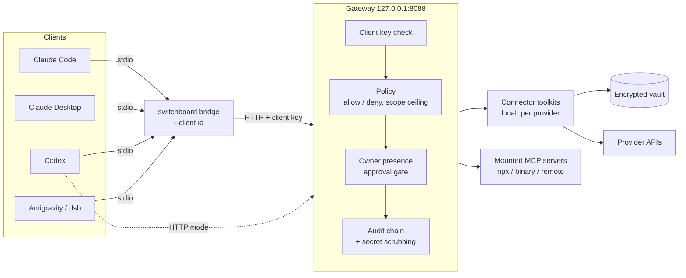

<div align="center">



<h1>MCP Switchboard</h1>

<p>
  <b>One local endpoint. Every MCP tool. Per-client keys, per-tool policy, a tamper-evident audit log.</b><br/>
  A governed, local-first MCP hub that runs on your machine and keeps your credentials there.
</p>

[](LICENSE)
[](docs/MCP_SWITCHBOARD_BASELINE.md)
[](package.json)
[](docs/VALIDATION.md)
[](docs/ARCHITECTURE.md)

[Quickstart](#quickstart) · [Architecture](#architecture) · [Connectors](#connectors) · [Security](#security-model) · [CLI](#cli-reference) · [Docs](#documentation)

</div>

---

## What it is

Switchboard is a gateway that sits between your agent clients (Claude Code, Claude Desktop, Codex, Antigravity and others) and the MCP servers and app connectors they use.
Clients talk to **one** endpoint on `127.0.0.1:8088` (streamable HTTP) or through a stdio bridge. Every call is checked against a per-client policy, gated by owner presence where it matters, and written to a hash-chained audit log.
Credentials live in a local encrypted vault. Nothing is hosted for you.

## Why

| | Hosted tool routers | MCP Switchboard |
|---|---|---|
| Where tokens live | Their cloud | Your machine (local vault) |
| Who can call what | Account-level | Per client, per server, per tool, with a scope ceiling |
| Approving risky calls | Dashboard click | Owner presence (Windows Hello where available) |
| Audit | Vendor logs | Local hash-chained log you can verify |
| Cost | Subscription | Free, Apache-2.0 |
| Trade-off | Zero setup, many prebuilt apps | You bring your own OAuth apps and keys; connector coverage is smaller |

The honest cost is setup: each provider needs an OAuth app or key that you own. See [docs/connectors/OWNER_SETUP.md](docs/connectors/OWNER_SETUP.md) and the cost comparison in [docs/PROVIDER_COST_COMPARISON.md](docs/PROVIDER_COST_COMPARISON.md).
Feature-by-feature positioning against a hosted hub is in [docs/COMPOSIO-PARITY.md](docs/COMPOSIO-PARITY.md).

## Architecture



Details, module by module: [docs/ARCHITECTURE.md](docs/ARCHITECTURE.md) and [docs/architecture/](docs/architecture/).

## Quickstart

Requires **Node >= 22.12**. Windows gets the full owner-presence flow (Windows Hello); other platforms fall back to a typed challenge at the gateway console, which [the threat model](docs/THREAT_MODEL.md) rates as weaker.

```bash
# 1. install and build
git clone https://github.com/Mas-AI-Official/mcp-switchboard.git
cd mcp-switchboard
npm install
npm run build

# 2. create a starter config and the home directory
node dist/cli.js init

# 3. start the gateway (127.0.0.1:8088)
node dist/cli.js serve

# 4. in another terminal: register a client and wire it up
node dist/cli.js client add claude-code
node dist/cli.js install claude-code --dry-run   # preview, changes nothing
node dist/cli.js install claude-code             # back up, write, probe

# 5. verify
node dist/cli.js doctor
node dist/cli.js list                            # governed tool list
```

`switchboard` and `mcp-switchboard` are the installed binary names (`npm link` or a global install exposes them); the examples above call `node dist/cli.js` directly.

Supported `install` targets: `claude-code`, `claude-desktop`, `codex`, `antigravity`, `dsh`, plus `gemini`, `cursor` and `vscode`.
Default mode is the stdio bridge (`switchboard bridge --client <id>`), which authenticates as that client. `--mode http` points the client at the gateway URL instead. `--scope project` writes the project-local config.

Rollback: `switchboard uninstall <client>` removes only the Switchboard entry, after taking a backup.

## Connectors

A connector is a local toolkit: provider auth definition, connected accounts held in the vault, and a generated MCP server per toolkit. Provider definitions are data, not code.

| Provider definitions | Toolkit overlays | Notes |
|---|---|---|
| `google` | `youtube`, `gmail`, `drive` | Google consent screen must be out of Testing or refresh tokens expire in 7 days |
| `meta-instagram`, `meta-facebook` | none | Needs your own Meta app |
| `higgsfield`, `elevenlabs` | none | Media generation; see owner setup |
| `x`, `slack`, `notion` | `x`, `slack`, `notion` | OAuth app you create |
| `github`, `linear`, `linkedin`, `tiktok`, `buffer` | none | See owner setup |
| `everything` | n/a | Reference MCP server (`@modelcontextprotocol/server-everything`) mounted in the example config, useful for testing |

The list above is read from `src/connectors/providers/` and `src/connectors/toolkits/`. **A definition existing is not the same as a proven live integration**: `switchboard coverage` counts a row as working only when an owner-run probe proved it. Per-platform steps, limits and checks: [docs/connectors/OWNER_SETUP.md](docs/connectors/OWNER_SETUP.md). Rules every connector must follow: [docs/CONNECTOR_CONTRACT.md](docs/CONNECTOR_CONTRACT.md).

Connect one provider:

```bash
printf '%s' '<client-id>'     | node dist/cli.js vault set myapp_client_id
printf '%s' '<client-secret>' | node dist/cli.js vault set myapp_client_secret
node dist/cli.js authconfig add <provider> --client-id-ref myapp_client_id --client-secret-ref myapp_client_secret
node dist/cli.js connect <provider> --account work
node dist/cli.js accounts probe <provider>/work
node dist/cli.js link <client> <toolkit>          # let a client use that toolkit
```

Token or key providers skip the app: `switchboard connect <provider> --token-stdin`.

## Security model

- **Per-client keys.** Each client has its own key. `client add` and `client rotate` on a running gateway require an owner presence check; `client rm` does not, since revoking is always safe. Key files are user-scope protected (DPAPI on Windows, mode 0600 elsewhere).
- **Policy per client per tool.** Every call is classified `read < write < full`, checked against the server ceiling and the client's `max_scope` and `max_risk`. Per-tool `enabled: false` is a hard deny. Upstream hints can only tighten a scope, never loosen it.
- **Owner presence.** High-risk calls wait for an out-of-band approval (`switchboard approvals`) that only the running gateway signs, after a presence check (Windows Hello where available).
- **Kill switch.** `switchboard kill on` refuses every tool call, resource read and prompt get; turning it off needs presence.
- **Audit.** `audit.log` is a SHA-256 hash chain; `switchboard audit verify` reports the first break. Write and full calls log an attempt row first and fail closed.
- **Secret hygiene.** Audit rows, errors and CLI output pass through a secret scrub (exact handled values, then token shapes). I/O capture in logs is off by default.
- **Network guard.** Outbound connector calls go through a guarded fetch with a host lock (`src/netguard.ts`).

What it does **not** do: it does not isolate two processes running as the same OS user, it has no multi-tenant mode, and it does not host anything publicly. See [docs/THREAT_MODEL.md](docs/THREAT_MODEL.md) for the full boundary and residual risks.

## CLI reference

Global option: `-c, --config <path>` (default `switchboard.config.yaml`). Run `switchboard <command> --help` for flags.

| Command | Purpose |
|---|---|
| `init` | Create a starter config and home directory |
| `serve` | Run the gateway (transports come from config) |
| `dashboard` | Run only the HTTP endpoint and web console |
| `doctor` | Check environment, config and credentials |
| `list` | Mount every server and print the governed tool list |
| `install <client>` / `uninstall <client>` | Register or remove Switchboard in an MCP client (preview, backup, probe, rollback) |
| `bridge --client <id>` | Relay a client's stdio to the gateway, authenticating as that client |
| `client add\|list\|rotate\|rm` | Register clients and manage their keys |
| `apikey` | Keys for the HTTP `/mcp` endpoint (remote clients, tunnels) |
| `link` / `unlink` / `links` | Grant or inspect which client may use which toolkit |
| `connect`, `accounts`, `authconfig`, `providers` | Connect provider accounts and register OAuth apps |
| `catalog`, `toolkits`, `coverage` | Browse providers and toolkits; honest working counts |
| `vault` | Locally stored secrets |
| `approvals` | List, show, approve or deny calls waiting for the owner |
| `audit verify` | Walk the audit hash chain |
| `kill on\|off\|status` | Global kill switch |
| `profile` | Named, switchable views over servers and tools |
| `expose` | Tunnel `/mcp` for remote clients such as ChatGPT (see threat model before use) |
| `local-llm` | Detect a local OpenAI-compatible server for the offline council |

## Protocol and compatibility

Built on MCP SDK v2. The gateway serves protocol **2026-07-28** and also the handshake-era protocols `2025-11-25`, `2025-06-18` and `2025-03-26`, so older clients keep working. Details: [docs/MCP_SWITCHBOARD_BASELINE.md](docs/MCP_SWITCHBOARD_BASELINE.md).

## Verification

Correctness is checked by deterministic oracles: scripts that compute their own verdict and exit non-zero on failure, with no model in the loop. The current run is **46 oracles, 4373 checks, all passing**.

```bash
npm run build
node scripts/run-oracles.mjs                      # all oracles, one table, sandboxed HOME
node scripts/run-oracles.mjs --only bridge,vault  # a subset
npm run verify                                    # build + npm audit + chain; stops at first failure
```

Each oracle runs with a throwaway `HOME` and `SWITCHBOARD_HOME`, and provider keys scrubbed from its environment. What the oracles do and do not prove: [docs/VALIDATION.md](docs/VALIDATION.md).

## Documentation

| Doc | Read it for |
|---|---|
| [ARCHITECTURE](docs/ARCHITECTURE.md) | Components and the single tool-call data flow |
| [THREAT_MODEL](docs/THREAT_MODEL.md) | Trust boundaries, mitigations, residual risk |
| [CONNECTOR_CONTRACT](docs/CONNECTOR_CONTRACT.md) | Rules every connector follows |
| [RUNBOOK](docs/RUNBOOK.md) | Operating and recovering a deployment |
| [VALIDATION](docs/VALIDATION.md) | Oracles, commands, what they prove |
| [MCP_SWITCHBOARD_BASELINE](docs/MCP_SWITCHBOARD_BASELINE.md) | As-built baseline of this branch |
| [PROVIDER_COST_COMPARISON](docs/PROVIDER_COST_COMPARISON.md) | Cost of providers vs hosted routers |
| [COMPOSIO-PARITY](docs/COMPOSIO-PARITY.md) | Feature parity against a hosted hub |
| [ROADMAP](docs/ROADMAP.md) | Phases shipped and planned |
| [VISION](docs/VISION.md) | Problem and positioning |
| [connectors/OWNER_SETUP](docs/connectors/OWNER_SETUP.md) | Per-platform OAuth app and key setup |

## Status

Version `0.1.0`, branch `vnext/governed-hub`. Alpha: the gateway, policy, presence, audit and bridge are covered by the oracles above; connector coverage grows as owners prove rows live. Planned work is in [docs/ROADMAP.md](docs/ROADMAP.md).

## License

[Apache-2.0](LICENSE). See [NOTICE](NOTICE).
